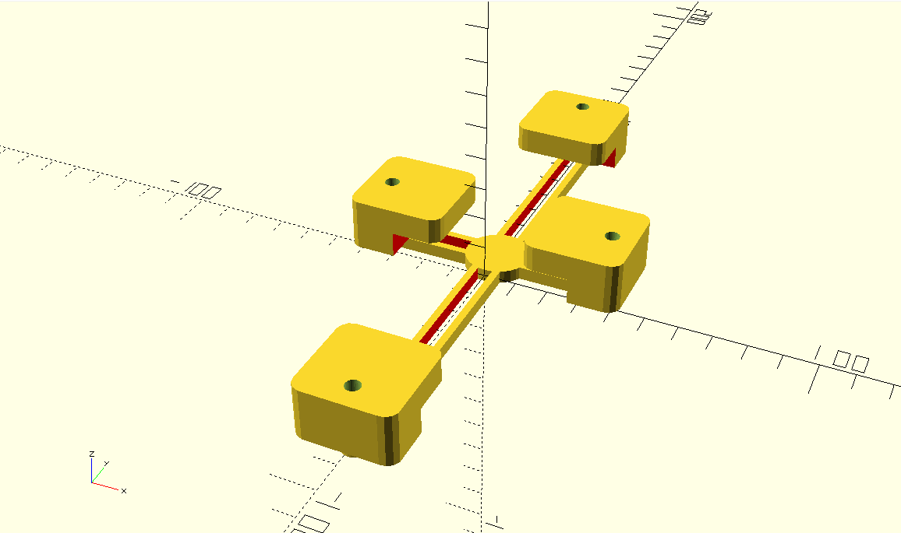

# Цифровой окуляр микроскопа

Модель в формате OpenScad для печати на 3D-принтере.

# Ссылки
1. [Universal Phone Microscope
Adapter] (https://www.thingiverse.com/thing:7422991) проект в сервисе thingiverse
